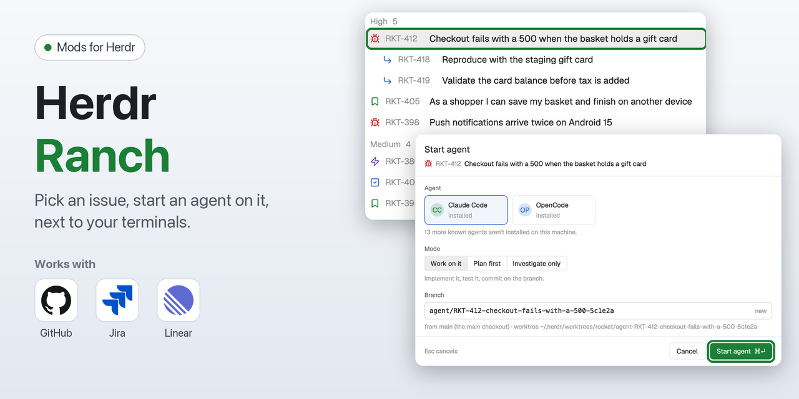
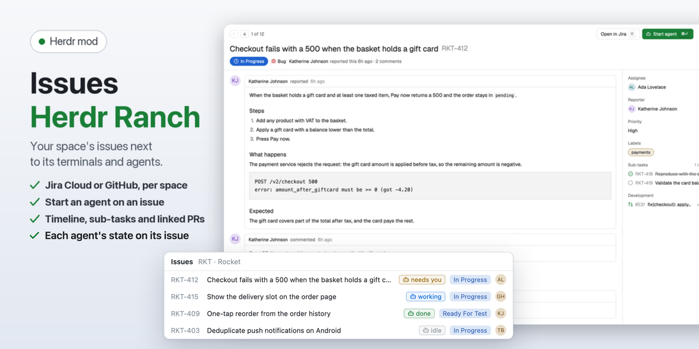
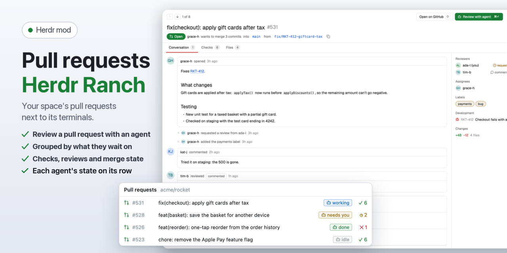
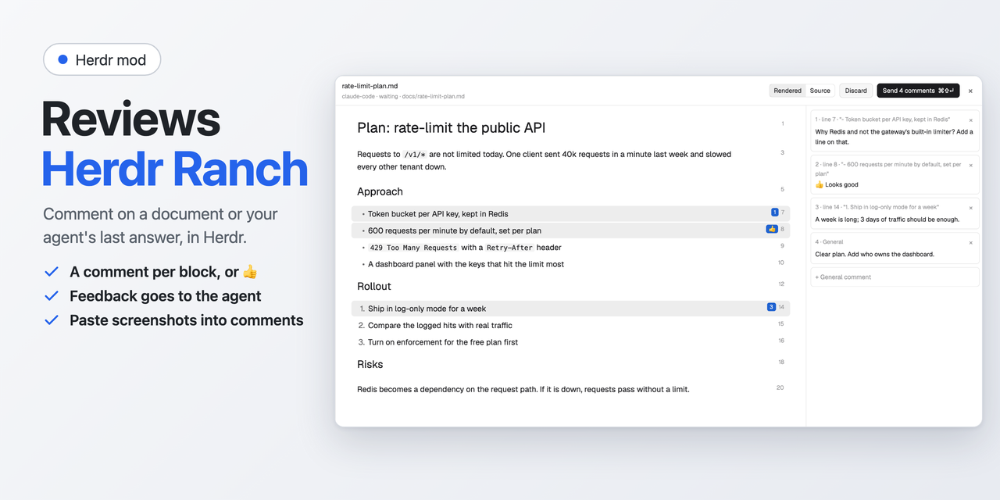
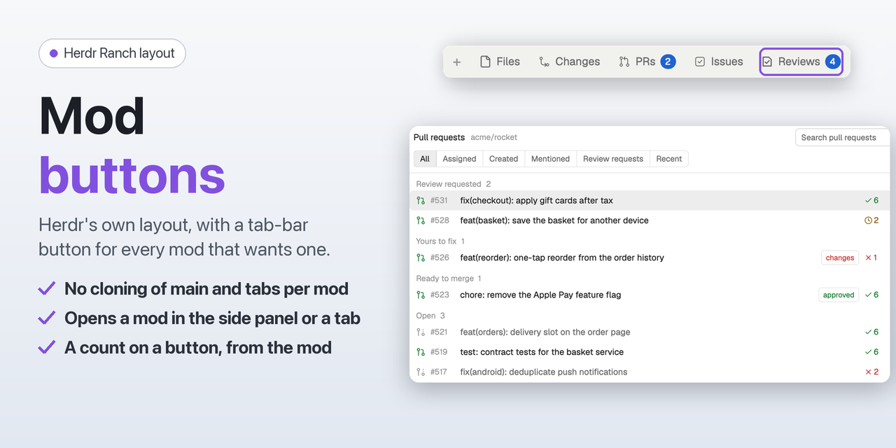

# Herdr Ranch



Three mods for the [Herdr](https://herdr.dev) desktop app. They show the work of the space you're in next to its terminals and agents. Plus a layout that gives each of them a button in the tab bar.

**It's opinionated.** It assumes code on GitHub, issues in Jira, Linear or GitHub, and agents working in their own worktrees; the mods only read, you act in the tools themselves. If you work differently, each mod installs on its own and its `RECIPE.md` lets your agent build a variant.

## Install

Tell your agent, in Herdr:

```text
Read ~/.config/herdr-app/AGENTS.md, then install everything from github.com/jslowack/herdr-ranch: the mods herdr-ranch-issues, herdr-ranch-prs and herdr-ranch-reviews (with its ranch-review CLI and skills), the mod-buttons layout, and their keys.json entries; then switch to the mod-buttons layout.
```

Or in a terminal:

```sh
git clone https://github.com/jslowack/herdr-ranch && cd herdr-ranch && ./install.sh --layout
herdr-app do layout.switch '{"name":"mod-buttons"}'
```

You get **Issues**, **PRs** and **Reviews** buttons next to Files and Changes.

**Needs:** [`gh`](https://cli.github.com) signed in, and `git`. `curl` for the avatars in Pull requests. Jira and Linear only for what you use; Node.js for Reviews. Tested on macOS; Linux and Windows follow their documented commands.

One mod at a time, keyboard shortcuts and updating: see [Install and update](docs/guide.md#install-and-update).

## Issues



The space's issues from Jira Cloud, Linear or GitHub. Each issue opens as a page like GitHub's. **Start agent** (⌘↵) opens a coding agent on it, in a new git worktree and space.

Link a space once from the cog: [Link a space](docs/guide.md#link-a-space), [Connect Jira](docs/connect-jira.md), [Connect Linear](docs/guide.md#connect-linear). More in [the guide](docs/guide.md#issues).

## Pull requests



The space's pull requests, grouped by what each one waits on: review requested, yours to fix, ready to merge. A page per pull request with checks, files and a merge box. **Agent review** checks it out, builds, tests and reports, without writing to GitHub.

More in [the guide](docs/guide.md#pull-requests).

## Reviews



Read what your agent wrote, comment on it in Herdr, and send the comments back to the agent. In Claude Code, type `/herdr-ranch-review <file>` for a plan or document the agent wrote to disk, or `/herdr-ranch-review-last` for the answer it just gave in chat. While the review waits, the agent shows under **Needs you**; click it there and the review opens. Click a block to comment on it, paste a screenshot, or give a 👍, then **Send N comments** (⌘⇧↵). The agent gets one message that quotes each block with your comment, and revises. **Approve as is** tells it to carry on; **Discard** sends nothing. The Reviews button counts what waits on you, in this space or all.

More in [the guide](docs/guide.md#reviews).

## History

The git commit history of the repository you're in, next to Files and Changes: by day, searchable across the whole history (`author:`, `path:`, `code:`, `since:`, a sha), and each commit's changes as diffs, unified or split. Only `git`, read only. See its [RECIPE.md](herdr-ranch-history/RECIPE.md).

## Changes

The uncommitted changes of the repository you're in, behind the tab bar's **Changes** button in the mod-buttons layout: every file as a card with its diff, unified or split and syntax highlighted, and a commit box. See its [RECIPE.md](herdr-ranch-changes/RECIPE.md).

## Files

Herdr's Files panel with syntax colors from `ranch-highlight`, behind the tab bar's **Files** button in the mod-buttons layout; **Editor** switches to Herdr's own editor. See its [RECIPE.md](herdr-ranch-files/RECIPE.md).

## Spaces

Herdr's spaces list with git and links, in the sidebar of the mod-buttons layout: each space's branch and ahead/behind, worktree spaces under their repository's space, and the repository's other worktrees (a click opens a space there). The shown space has **Link space** and **New worktree** buttons; a linked space shows its Jira, Linear or GitHub link as a chip that opens Link space. Right-click a space for Link space, New, Open and Remove worktree, Rename and Close. Every checkout shows its outstanding work (`●` uncommitted files, `↑` unpushed commits); right-click a worktree without a space to create a space there or delete it. **New worktree** starts from a branch or from one of your issues. See its [RECIPE.md](herdr-ranch-spaces/RECIPE.md).

## Agents

Herdr's agents list with Claude Code's own records, in the sidebar of the mod-buttons layout: the context each Claude Code agent uses, a popup with its model, usage, tasks and subagents, and its task list and running subagents under its row. See its [RECIPE.md](herdr-ranch-agents/RECIPE.md).

## Highlighting

The diffs in Pull requests and History are syntax highlighted by `ranch-highlight`, a small tree-sitter helper in Rust (`ranch-highlight/`): CFML (with cfscript, `<cfquery>` SQL and embedded HTML, CSS and JS) and 19 other common languages. `install.sh` builds it when Rust is installed ([rustup.rs](https://rustup.rs)); without it the diffs stay plain.

## The mod-buttons layout



Herdr's own layout, with a tab-bar button for every installed mod that declares one. It works for any mod, not only these. To add a button to your own mod, see [mod-buttons/RECIPE.md](mod-buttons/RECIPE.md). [herdrdev/herdr-app#246](https://github.com/herdrdev/herdr-app/issues/246) asks for this in Herdr itself.

## What it touches

- **Read only.** Nothing is written to Jira, Linear or GitHub. Start agent creates a local worktree and branch, and pushes nothing.
- **Tokens** go to your system's credential store, never into Herdr's settings.

Every program, host and file it uses: [docs/reference.md](docs/reference.md#what-they-run-and-store).

## Recommended

Mods by others that go well with Herdr Ranch. Install them the way their own README says; the mod-buttons layout gives each a button, even when its `mod.json` declares none.

### Automations

[DnzzL/herdr-automations](https://github.com/DnzzL/herdr-automations) (MIT): agent prompts on a schedule, such as a morning triage or a nightly dependency check. A run opens as a space in the app. Follow its section "In the Herdr desktop app"; you can skip its layout step, the mod-buttons layout adds its button.

## More

- [Guide](docs/guide.md): install options, linking a space, Start agent, your own prompts.
- [Reference](docs/reference.md): what runs and what is stored, install flags, keys.
- [CHANGELOG.md](CHANGELOG.md): what changed per version.
- Each mod's `RECIPE.md`: the brief an agent builds it from ([Issues](herdr-ranch-issues/RECIPE.md), [Pull requests](herdr-ranch-prs/RECIPE.md), [Reviews](herdr-ranch-reviews/RECIPE.md), [mod-buttons](mod-buttons/RECIPE.md)).
- [CONTRIBUTING.md](CONTRIBUTING.md): tests, shared code, how the repository is laid out.

## License

[MIT](LICENSE).
