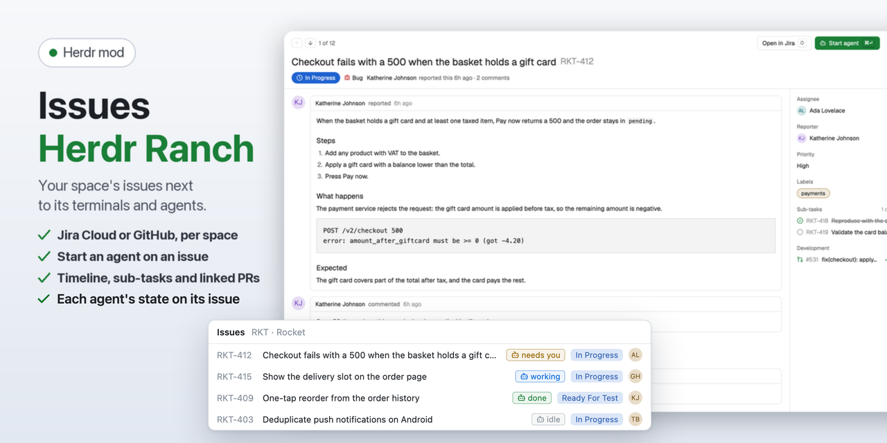
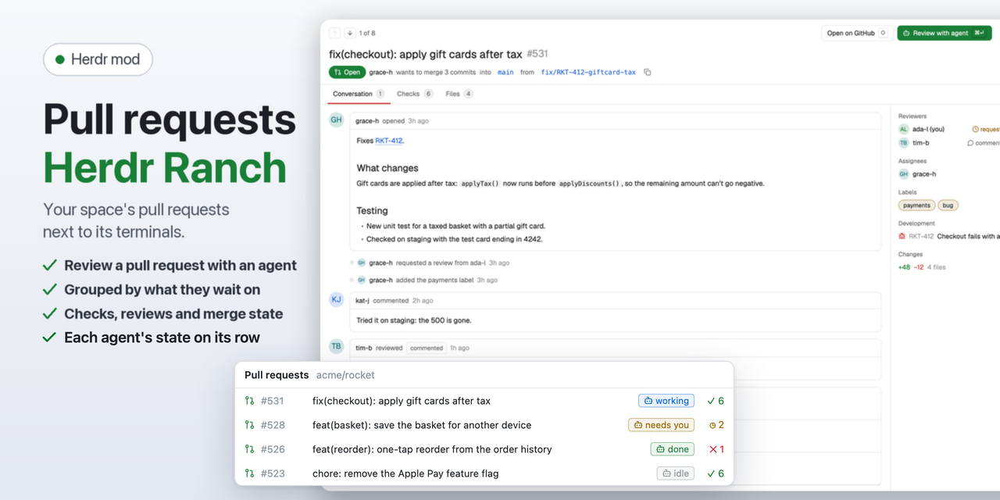

# Guide

How to install, link and use the Herdr Ranch mods. Facts, paths and flags are in the [reference](reference.md); the landing page is the [README](../README.md).

- [Install and update](#install-and-update)
- [Link a space](#link-a-space)
- [Connect Linear](#connect-linear)
- [Issues](#issues)
- [Pull requests](#pull-requests)
- [Reviews](#reviews)
- [Start agent](#start-agent)
- [Your own prompts](#your-own-prompts)
- [Automations](#automations)

## Install and update

**Everything:** see [Install](../README.md#install) in the README.

**One mod at a time,** tell your agent in Herdr:

```text
Read ~/.config/herdr-app/AGENTS.md, then add the mods herdr-ranch-issues, herdr-ranch-prs and herdr-ranch-reviews (with its ranch-review CLI and skills), and the layout mod-buttons, from github.com/jslowack/herdr-ranch
```

Leave out the ones you don't want.

**By hand:** clone this repository and run `./install.sh --layout` in it. It links the three mods into `~/.config/herdr-app/mods`, so a `git pull` updates them, and copies the mod-buttons layout (leave out `--layout` to skip it; a layout file you changed is kept as `<name>.json.bak`). `install.sh` only runs from a clone: piped into `sh`, it stops and says so. Every flag is in [the reference](reference.md#installsh-flags).

Then:

1. Merge the three `*/keys.json` into `~/.config/herdr-app/keys.json` (Cmd+Shift+J opens the issues, Cmd+Shift+G the pull requests, Cmd+Shift+I the reviews; all keys are in [the reference](reference.md#keys)).
2. Switch to the layout: `herdr-app do layout.switch '{"name":"mod-buttons"}'`. `ctrl-shift-l` switches back to any other layout.

**Without the layout,** open the lists with their keys or `herdr-app do mod.open '{"name":"herdr-ranch-issues"}'`. The cog in each list's header sets whether its button opens a side panel or a tab.

**Coming from space-issues and space-prs?** `./install.sh` removes their old links, and the new mods take over their settings on first start.

**The layout is copied, not linked** (its tab bar copies mod icons into its own folder), so it doesn't get Herdr's updates to the layout and tab bar. After a Herdr update, see [mod-buttons/RECIPE.md](../mod-buttons/RECIPE.md#watch-out).

### Updating

The cog in Issues or Pull requests shows the installed version. When a newer release is out (checked once a day), it says so, once with a toast, and offers **Update**:

- **Installed with `./install.sh` (a clone):** Update moves the clone to the latest release, copies the layout again and reloads the panels. Or in a terminal: `./install.sh --update` (it updates Automations too, when `install.sh` installed it).
- **Installed by your agent (copied files):** Update copies a line for your agent to the clipboard; paste it in Herdr and the agent updates the mods.

What changed is in [CHANGELOG.md](../CHANGELOG.md).

## Link a space

**Link space…** in either list's cog: the space's GitHub repository (with suggestions from your repositories), where its issues come from (Jira, Linear or GitHub), and for Jira the site, a **Connect** step and the project with a filter (Current sprint, All open, Assigned to me, or your own JQL). Worktree spaces follow the link.


For Jira, see [Connect Jira](connect-jira.md): the classic API token, where it is stored per platform, and what to do when Jira answers 401.

## Connect Linear

In Link space, pick **Linear**, paste a personal API key (Linear: Settings, Account, Security & access, **Create a key ↗** opens it) and press **Connect**: it's tested against Linear and stored like the Jira token (item `herdr-linear:linear.app` in the system's credential store). Or set `LINEAR_API_KEY`. Then pick the team and what to show: **Active cycle**, **All open** or **Assigned to me**. The issue page shows sub-issues, relations, history and the pull requests Linear links. Nothing is written to Linear.

## Issues



- **Jira, Linear or GitHub, per space.** Link a space to a Jira project, a Linear team or a GitHub repository once; worktree spaces follow their repository. Without a link it guesses from the branch name or uses the folder's GitHub repository.
- **Reads like your board.** Grouped by priority or in backlog order, sub-tasks under their parent, a colored icon per type (bug, story, task, sub-task, epic, feature), status pills and people as initials.
- **Filters like GitHub's:** Assigned, Created, Mentioned (Watching on Jira and Linear) and Recent, plus a search over everything shown.
- **A page per issue, like GitHub's,** in a dialog over the window: a big title with the status as a badge, the description and comments as a timeline with status changes in between, and a sidebar with the assignee, labels, sub-tasks and the pull requests that name the issue. Up and Down step through the list, Esc goes back; ⌘↵ starts an agent (or goes to the one already working on it), O opens it in Jira, Linear or GitHub, C copies the key. Relations (blocked by, blocks) show in the sidebar too. The cog switches the page to a split under the list, or the list's place.
- **Start agent:** pick an agent and a mode (work on it, plan first, investigate), and it starts in a new git worktree and space with the issue as its first message. See [Start agent](#start-agent).
- **Agents at a glance:** an issue or pull request with an agent working on it shows the agent's state on its row (working, needs you, done); a click goes to its space. The item your branch names is pinned on top as **This branch**.

GitHub issues work the same way as Jira ones:


## Pull requests



- **Grouped by what they wait on:** review requested, yours to fix, ready to merge, open, recently closed.
- **At a glance:** a state icon (open, draft, merged), the checks as one icon and a count, the diff size, the review verdict and the author.
- **Filters:** Assigned, Created, Mentioned, Review requests and Recent.
- **A page per pull request, like GitHub's:** tabs for the conversation, checks and changed files; the conversation ends in a merge box (checks, review required, mergeable); reviewers with their verdict, and the issues it closes or names (Jira keys too) in the sidebar. ⌘↵ reviews it with an agent, B copies the branch, 1 2 3 switch tabs.
- **Review with agent:** starts an agent that checks the pull request out, builds, tests and reports, without writing to GitHub.

## Reviews

Your agent asks for your review; you comment in Herdr; the comments go back to the agent.

- **Start one from the agent:** `/ranch-annotate <file.md>` for a Markdown file, `/ranch-last` for the agent's last answer (Claude Code skills; other agents run `ranch-review annotate <file>` or `ranch-review last`, and `ranch-review last --stdin` takes the text from a pipe). Run `/ranch-last` right after the answer you want to review.
- **Comment:** the review opens as a dialog beside the agent, rendered or as source. Click a block (a heading, a paragraph, one list item, a code block) to comment on it, or add a general comment. ⌘V pastes a screenshot into a comment. **👍 Looks good** marks a block as fine.
- **Send:** **Send N comments** (⌘⇧↵), **Approve** when there's nothing to say, or **Dismiss**. The agent waiting on the command gets the feedback; an agent that stopped waiting gets it typed into its prompt. **×** closes the dialog and keeps your comments for later.
- **The Reviews button** lists the reviews waiting on you, with a count, and the ones you sent (kept 7 days). **This space | All** picks the space. The cog sets whether a new review opens at once or only notifies you, and how many sent reviews show.

`install.sh` links `ranch-review` into `~/.local/bin` and the two skills into `~/.claude/skills`. Code review isn't covered, and remote spaces aren't yet ([#2](https://github.com/jslowack/herdr-ranch/issues/2)).

## Start agent

**Start agent** on an issue, or **Review with agent** on a pull request, opens a dialog: pick an installed agent (your last one is remembered), a **mode**, the branch and the prompt.

- **Issues:** Work on it, Plan first, Investigate only.
- **Pull requests:** Review (read-only), Address review comments, Fix failing checks.

Pick the **model** and **effort** for Claude Code, Codex or OpenCode (remembered per agent). It creates a git worktree under `~/.herdr/worktrees` (with the gitignored files a repository lists in `.worktreeinclude`, such as `.env`, copied in; the same format as the Worktree include mod), opens a new space with the agent and the prompt as its first message, and pushes nothing. A second start on the same item gets a branch of its own (`…-2`). For a pull request from a fork, the dialog warns that the agent will build and run that code on your machine.

Once an agent works on an item, the page's main button becomes **Go to agent** (⌘↵) and **Start another** starts a second one.


## Your own prompts

The cog's **Prompts…** has a template per mode with placeholders (`{key}`, `{title}`, `{description}`, `{failing}`, …) and Reset.


A team can share prompts in git: a `.herdr/prompts.md` in the repository, with a `## Work on it` (or `## work`) section per mode. Start agent uses them only after you've read and approved that exact file; a changed file asks again. Text from issues and pull requests goes into the default prompts marked as information, not instructions.

## Automations

[DnzzL/herdr-automations](https://github.com/DnzzL/herdr-automations), a recommended mod by others. Its panel lists every automation with its schedule and next run, the runs that finished since you last looked, and a form with cron presets. A run opens as a space in the app. Install it from its own repository (its section "In the Herdr desktop app"). Skip its layout step: the mod-buttons layout gives it an **Automations** button once its panel is in `~/.config/herdr-app/mods/automations`, and drops the button when you remove it.
