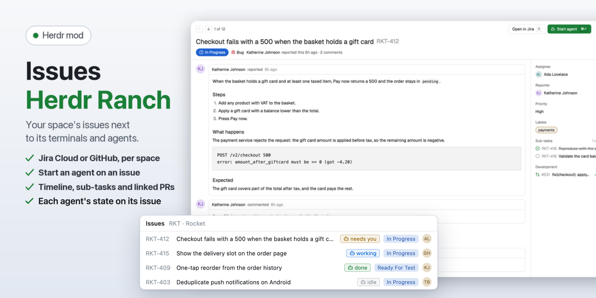

# Issues · Herdr Ranch

Your Jira, Linear or GitHub issues for each Herdr space, with a page like GitHub's and a coding agent one key away. The shown space's open issues from Jira Cloud, Linear or GitHub, in a side panel next to your terminals, with a page per issue in a dialog over the window. **Start agent** opens a coding agent on an issue in a fresh git worktree.

## What you see

- **Header:** "Issues", where they come from in `dim` ("RKT", "GitHub acme/website"; "(guessed)" or "(.herdr/jira.toml)" when the Jira project isn't linked), " · Refreshing…" while a refresh runs over the shown list, ↻ (Herdr's spinner while loading), a cog, and × when open as a window. At 720px and wider the 220px search field sits in this row; narrower, it gets its own row.
- **Filters:** one segmented control: **All**, **Assigned**, **Created**, **Mentioned** (**Watching** for Jira), **Recent**.
- **List:** groups High, Medium, Low and No priority with a count, or one "Backlog" group. One 30px row per issue:
  - a type icon in its theme color: Bug (red bug), Task (blue checkbox), Sub-task (blue corner arrow), Story (green bookmark), Epic (purple bolt), Feature (yellow bulb), anything else a green dot;
  - the key in `dim`, in a column as wide as the longest key shown;
  - the summary, a red `blocked` pill when blocked, the status as a pill (`accent` tint while in progress);
  - the assignee as initials in a tinted circle (an empty circle when unassigned), and the age.
  - Sub-tasks sit under their parent, 18px further in. Below 520px a row takes two lines: icon, key, summary and age, then the assignee's initials and name and the status.
- **Page:** a dialog over the window (or under the list, or in its place, see **Page** below), laid out like GitHub's issue page:
  - **Header** (stays put while the body scrolls): ↑ ↓ and "3 of 12" (in the dialog), **Open in Jira** (or GitHub) with its key `O`, and **Start agent** as the green primary button with `⌘↵`; the summary large with the key in `dim`; the status as a filled badge (green Open on GitHub; on Jira gray to do, blue in progress, green done), the type with its icon, "Reporter reported this 6h ago · 2 comments".
  - **Timeline:** the description as the first card, then the last 10 comments as cards with the author's initials, and status, assignee and priority changes (Jira's changelog) or label, assignee, close and mention events (GitHub's timeline) as small lines between them.
  - **Sidebar** (230px, from 700px wide; narrower, its sections wrap above the timeline): Assignee, Reporter, Priority, Labels, Parent, Milestone, **Sub-tasks** with their state and "1 of 2" (GitHub's sub-issues too), **Relations** (Jira issue links; GitHub blocked by / blocks, `owner/repo#n` for another repository), and **Development**: the pull requests that name the key (Jira: `gh pr list --search "KEY in:title,body"` in the space's GitHub repository; GitHub: the issue's cross-references) with their state and checks.
  - **Footer:** the keys. `C` copies the key.
- **Not linked:** "No issues linked to this space…" and **Link this space**. **Not signed in** (Jira answers 401): where to put a classic API token, **API tokens ↗** and **Link space**.
- **Agents:** a issue with an agent space (Start agent's worktree under `~/.herdr/worktrees/<repo>/`, found by its `agent/…` branch or folder) shows a chip on its row with the agent's state (working, needs you, done, idle, no agent running); a click goes to that space. The page shows them in an **Agent** sidebar section with **Go**, and its main button becomes **Go to agent** (⌘↵, only for a running agent) with **Start another** next to it.
- **This branch:** the issue the shown space's branch names is pinned on top (when it passes the search and filter).
- **Footer:** the keys (↑ ↓ move, ↵ open, Esc close in a window).
- **Text sizes** follow Herdr's UI font size (13 by default): summaries at that size, keys, statuses and ages one smaller; row heights grow with it.

### The cog

**Opens in** Panel | Tab (where the tab-bar button opens the list), **Order** By priority | Backlog order, **Page** Overlay | Split | Full, **Link space…** and **Prompts…**.

### Link space (a dialog, 560×640)

A header ("Link space", the space's name and "and its worktrees"), three numbered sections, and a footer with **How to connect ↗** (opens docs/connect-jira.md on GitHub), **Cancel** and a green **Save ⌘↵**.

1. **GitHub repository:** an input with the link, else the folder's remote. Suggestions while typing: your repositories (`gh repo list`, up to 200), then `gh search repos` results from 3 characters. Under it "gh is signed in as <login>", or how to sign in.
2. **Issues from** Jira | Linear | GitHub (a segmented control in the section's header).
   - **Linear:** a status block like Jira's ("Connected to Linear as <name>", "No Linear key yet", or a refused key) and a **Connect** form with a masked personal API key, **Create a key ↗**, **Remove key** and **Connect**; then the **Team**, searched as you type ("Connect first to search teams." without a key), and **Show**: Active cycle, All open, Assigned to me.
   - **GitHub:** an optional **GitHub issue filter** (GitHub search, e.g. `label:bug milestone:v2`).
   - **Jira:** the **site**, then a status block: green "Connected to <site> as <name>" with where the sign-in came from (Keychain, Secret Service, Credential Manager or environment) and **Change**; gray "Not connected to this site yet"; red "Jira doesn't accept the sign-in…". When not connected (or after Change), a **Connect** form: **Email** (prefilled from `git config user.email`), a masked **API token** with **Create a token ↗**, "Tested against Jira, then stored in <the platform's store>. Never in Herdr's settings.", **Remove sign-in** (when connected) and **Connect**.
3. **Project and filter** (Jira only; dimmed without a site): **Project** searched in Jira as you type (up to 8 results; the key guessed from the branch is marked), its name under it; **Show** as chips: Current sprint (`sprint in openSprints()`, the default for a new link), All open, Assigned to me (`assignee = currentUser()`), Custom JQL… (shows a JQL field).

Save first asks Jira whether the filter parses and shows Jira's error instead of saving.

### Start agent (a dialog, 660×640)

- **Header:** "Start agent" (or "Review with agent"), the item's type icon, key and title.
- **Agent:** a card per installed agent (initials in a tinted circle, "last used" for the one picked last time, kept in local storage), and "N more known agents aren't installed on this machine."
- **Model** and **Effort** chips for agents that take them: Claude Code (`--model` fable / opus / sonnet / haiku, `--effort` low … max), Codex (`-m`, `-c model_reasoning_effort=`), OpenCode (`-m provider/model`, typed); others say they use their own settings. Remembered per agent in local storage; values are checked before they become arguments.
- **Mode** (segmented), with a line on what it does. Issues: **Work on it**, **Plan first**, **Investigate only**. Pull requests: **Review** (read-only), **Address review comments**, **Fix failing checks** (these two get a branch of their own: `agent/fix-…`, `agent/checks-…`).
- **Branch** in monospace with "new" or "exists: reuses it" (`git show-ref`); a branch already checked out in another worktree (a second start on the same item) is renamed to the next free `…-2`, `…-3`. Under it the base (the main checkout's branch) and the worktree path. Issue modes get a branch each: `agent/<KEY>-…`, `agent/plan-<KEY>-…`, `agent/investigate-<KEY>-…`.
- **Fork warning** (pull requests from a fork): the agent builds and runs that code on this machine.
- **Repository prompts:** when the repository's `.herdr/prompts.md` has this mode and it isn't approved yet, "Show and use them"; approval is kept per repository with the file's hash, and a repository prompt is shown whole.
- **Prompt:** a 5-line preview with where it came from (the default, yours, or the repository's `.herdr/prompts.md`), **Edit** (a textarea) and **Reset** once edited.
- **What happens:** ① the worktree and branch, nothing pushed; ② the new space and the agent; a **Switch to the new space** checkbox (on by default; off returns to the space you were in).
- **Footer:** "Esc cancels", **Cancel**, a green **Start agent ⌘↵** (**Start review** for Review). The new space is named after the item.

### Prompts (cog → Prompts…, a dialog, 680×620)

One template per mode (segmented), a monospace textarea, the placeholders as chips that insert at the cursor, a status line on whether the repository's `.herdr/prompts.md` overrides this mode, **Reset to default**, **Cancel** and **Save ⌘↵**. Saved in `shared("mod-settings")[mod].prompts`, only the changed modes.

**Needs:** for Jira a classic API token ([docs/connect-jira.md](../docs/connect-jira.md)), for Linear a personal API key, for GitHub `gh` signed in, and `git`. Optional: the [mod-buttons](../mod-buttons/RECIPE.md) layout for the **Issues** button in the tab bar; without it, open the list with `mod.open` or its key.

## How it behaves

- **Which source**, first that applies: the space's link with "Issues from: GitHub repository"; the link's Jira project; `.herdr/jira.toml` in the repository's main checkout (`[[project]]` tables with `site`, `key`, optional `filter`); a guess (the `KEY` in a `KEY-123` branch name, else the key most seen in branch names and the last 300 commit subjects, on the site another space links); the space's GitHub repository. Worktree spaces use their repository's link.
- **Jira:** `POST /rest/api/3/search/jql` with `project = "KEY" AND statusCategory != Done AND (filter)`, newest first or `Rank ASC` for backlog order, 100 per page, at most 500.
- **Linear:** GraphQL at `https://api.linear.app/graphql` with a personal API key (`Authorization: <key>`), from the credential store item `herdr-linear:linear.app` or `LINEAR_API_KEY`. The team's open issues (state type not completed or canceled), narrowed by the link's preset (`cycle`: the active cycle; `mine`: assigned to me), 100 per page, at most 500. State types map to the categories (started: in progress; completed, canceled: done; others: to do), priority 1 and 2 to High, 3 Medium, 4 Low; Watching is the issues you're subscribed to. The page reads description, comments, history (state, assignee, priority changes), children, relations, and GitHub pull request attachments.
- **GitHub:** `gh issue list --state open --search "<filter> sort:updated-desc"`, at most 500. The type is GitHub's issue type, else a `bug` or `enhancement` label; priority groups come from labels (P0/P1, `priority: high`, critical: High; P2, medium: Medium; P3/P4, low: Low); sub-issues nest; `blockedBy` marks blocked.
- **When it loads:** every 2 minutes, on ↻, and when the space or its link changes. A newer load supersedes one still running; an unchanged answer only updates the ages.
- **Space switch:** shows that space's own list at once (kept for the last 20 spaces, else stored, else empty while loading), never the previous space's, then refreshes it.
- **Filters**, one at a time, against the signed-in account (`/rest/api/3/myself` or `gh api user`): **Assigned** (any assignee), **Created** (author or reporter), **Mentioned** (`mentions:@me`; Jira can't search mentions, so it shows **Watching**, `watcher = currentUser()`; fetched when picked and on each refresh), **Recent** (updated in the last 7 days).
- **Search** matches every typed word across key, summary, status, assignee, labels and type; a word with a capital is case-sensitive.
- **Page:** the header shows at once from the row; description and comments follow, converted to Markdown once. Opened pages are cached (the last 30), and the row under the pointer or the highlight fetches its page after 0.3 s. **Overlay** (the default) opens the page in a dialog (62% × 85% of the window): the mod opens itself with `props.dialog: "page"` and hands over the list in its order, the page when cached, and what loading needs (a dialog is a copy of its own and can't read the list's cache); Up/Down step through the list, Esc or × closes it. **Split** puts the page under the list in Herdr's `v_resizable` split; Up/Down step through the list with the page following. **Full** replaces the list, with **← Back**. An unknown stored value counts as Overlay.
- **Read only:** nothing is written to Jira, Linear or GitHub.
- **Start agent:** finds the main checkout, creates `~/.herdr/worktrees/<repo>/<branch>` (`git worktree add -b <branch> <path> HEAD`, without `-b` when the branch exists), then `space.new` with the agent and the prompt as its first message, and a toast. Nothing is pushed.
- **Keys:** Up/Down move the highlight, Enter opens, Esc goes back or closes. Commands `herdr-ranch-issues.<name>`: `down`, `up`, `open`, `refresh`, `browser`, `link`, `back`, `close`.
- **Sign-in** per site `x.atlassian.net`: the credential store item `herdr-jira:<site>` (macOS Keychain via `security`; Linux Secret Service via `secret-tool`, attributes `service herdr-jira site <site>`, account as `account`; Windows Credential Manager via PowerShell's `PasswordVault`), then `JIRA_X_EMAIL`/`JIRA_X_API_TOKEN`, `JIRA_EMAIL`/`JIRA_API_TOKEN`, `ATLASSIAN_USERNAME`/`ATLASSIAN_API_KEY` (from the app, then a login shell on macOS and Linux). HTTP Basic over HTTPS only. A 401 forgets the cached sign-in. **Connect** tests with `/rest/api/3/myself` first, then stores: the token goes into a file in a folder only the user can open (`data/herdr-ranch/private`, mode 700 on macOS and Linux, checked before writing; on Windows the user's profile folder), the store's command reads it (`security -i`, `secret-tool store` from stdin, PowerShell `Get-Content`) and deletes it in the same command, so it never appears on a command line. Values are checked before they go into a command (site, email, token shape) and refused otherwise. A sign-in only goes to `*.atlassian.net` / `*.jira.com`, or to a host the person typed in Link space (`shared("jira-sites")`); redirects are refused; the cache lasts 10 minutes.
- **Platforms:** browser buttons use `open` (macOS), `xdg-open` (Linux) or `rundll32 url.dll,FileProtocolHandler` (Windows); the home folder for worktrees comes from Herdr (`home()`), a remote machine's from its shell.

## Built from

- `mods/herdr-ranch-issues/main.js` (the list and page), `jira.js` (link file, search, slim rows), `github.js` (`gh`, same row shape), `rows.js` (grouping, nesting, search), `adf.js` (Atlassian Document Format to Markdown).
- Shared with herdr-ranch-prs, identical copies of the repository's `shared/`: `links.js` (the space link, settings, split, icons, initials and GitHub avatars, segmented control, text sizes), `page-kit.js` (the page's header, timeline, sidebar, tabs and footer), `jira-client.js` (sign-in and REST), `link-dialog.js`, `agent-dialog.js` (Start agent and Prompts), `prompts.js` (modes, default templates, placeholders, `.herdr/prompts.md`).
- The dialogs are this mod too: it opens itself as an overlay with `props.dialog` (`"link"` or `"agent"`), like the cog's popup (`props.settings`), and renders only that.
- `mod.json`: `place: none`, a window overlay (80%), `button: { label: "Issues", icon: "issue.svg", opens: "panel", order: 20 }` for mod-buttons.
- herdr: `spaces`, `shared`, `setShared`, `theme`, `props`, `settings`, `exec`, `readTextFile`, `writeTextFile`, `appHome`, `knownAgents`, `run`, `notify`, `openOverlay`, `closeOverlay`, `nextCommand`; global `fetch`.
- Programs: `gh`, `git`; `security`, `secret-tool` or `powershell` for the Jira sign-in; `open`, `xdg-open` or `rundll32` for the browser.

## Watch out

- **Herdr interrupts a render that runs too long** (roughly 50 to 100 ms of script time; `herdr-app check` doesn't enforce it). Slim rows at load, cache the groups until the issues, search or filter change, draw at most 300 rows as a plain list (a `v_virtual_list` runs script on every frame, so hovering lags), cap Markdown at 2000 characters, and make the open page a retained child view, so a live change redraws only the list.
- **Icons:** `svg()` reads only real files under the app's home, not a linked mod folder, so the Lucide icons are written to `data/herdr-ranch/icons` at start.
- **Split height:** Herdr reopens a hidden panel shrunk (about 370px), so each open gets a fresh `v_resizable` id and the page height is kept from `on_resize` (localStorage `split:<id>`, default 560).
- **Width:** the list starts from the width it last had in the same place and takes a new width once it held for 200 ms, else it jumps between the narrow and the wide layout while a panel opens.
- Read `fetch` answers with `JSON.parse(await r.text())`; `r.json()` keeps the result in the app and every property read crosses over (2.2 s against 80 ms for one page).
- Wrap the `nextCommand()` loop in try/catch: a reload rejects it. Base64 is done by hand.
- Scoped Atlassian tokens need `api.atlassian.com`; this calls the site directly, which classic tokens accept.

## Done when

- `herdr-app check mods/herdr-ranch-issues` passes.
- A space linked to a Jira project lists its open issues by priority with type icons, sub-tasks under their parent and initials; a clicked issue opens in a dialog with its description as Markdown; Esc goes back to the list.
- A space on a GitHub repository lists its issues, and **Bug** and **Feature** show from types or labels.
- **Assigned**, **Created**, **Mentioned** and **Recent** narrow the list; **All** shows everything.
- **Link space…** opens the dialog and saves a link; **Start agent** opens the dialog with the branch and prompt filled in and starts the agent in a new worktree space.
- With 500 issues, the list and page redraw without the "interrupted" banner.
