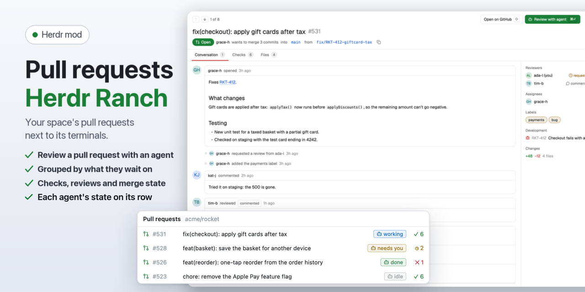

# Pull requests · Herdr Ranch

GitHub pull requests for each Herdr space, grouped by what they wait on, with a merge box and a review agent. The shown space's pull requests in a side panel next to your terminals, grouped by what each one waits on, with a page per pull request in a dialog over the window. **Review with agent** starts a coding agent that reviews one in a fresh git worktree.

## What you see

- **Header:** "Pull requests", the repository in `dim`, " · Refreshing…" while a refresh runs over the shown list, ↻ (Herdr's spinner while loading), a cog, and × when open as a window. At 720px and wider the 220px search field sits in this row; narrower, it gets its own row.
- **Filters:** one segmented control: **All**, **Assigned**, **Created**, **Mentioned**, **Review requests**, **Recent**.
- **List:** groups with a count: Review requested, Yours to fix, Ready to merge, Open, Recently closed (the last 10). One 30px row per pull request:
  - a state icon: open (green), draft (`dim`, with a `muted` title), merged (purple), closed (red);
  - `#number` in `dim`, the title;
  - an `approved` (green) or `changes` (red) pill when the review has a verdict;
  - the checks as one icon and a count: ✗ failing (red), a clock while running (yellow), ✓ passing (green);
  - `+add −del`, the author as initials in a tinted circle, and the age.
  - Below 520px a row takes two lines: icon, number, title and age, then the author's initials and name, the diff, the checks and the pill.
- **Page:** a dialog over the window (or under the list, or in its place, see **Page** below), laid out like GitHub's pull request page:
  - **Header:** ↑ ↓ and "1 of 8", **Open on GitHub** (`O`) and **Review with agent** as the green primary button (`⌘↵`, open pull requests only); the title large with `#number`; a badge (Open green, Draft gray, Merged purple, Closed red), "author wants to merge 3 commits into `base` from `head`" with the branches as code and a copy button (`B`).
  - **Tabs** (`1` `2` `3`): **Conversation** (count of comments), **Checks** (failing first, each with its icon and conclusion), **Files** (path, +, −; at most 300).
  - **Conversation:** the description as the first card, comments and reviews (with their verdict as a pill) as cards, and review requests, labels, pushes, merging and closing (the issues timeline API) as small lines; it ends in the **merge box**: checks (all passed, n failing, n running; a click opens Checks), the review state ("You were asked to review" when you were), and mergeability (ready, conflicts, behind, blocked, merged), with "Merge on GitHub: these mods never write to GitHub."
  - **Sidebar:** Reviewers with their verdict ("(you)" for you), Assignees, Labels, **Development** (issues it closes, and Jira keys in its title, branch or description with their summary when the space links a Jira site), Changes.
  - **Footer:** the keys.
- **Agents:** a pull request with an agent space (Start agent's worktree under `~/.herdr/worktrees/<repo>/`, found by its `agent/…` branch or folder) shows a chip on its row with the agent's state (working, needs you, done, idle, no agent running); a click goes to that space. The page shows them in an **Agent** sidebar section with **Go**, and its main button becomes **Go to agent** (⌘↵, only for a running agent) with **Start another** next to it.
- **This branch:** the pull request the shown space's branch names is pinned on top (when it passes the search and filter), only for a branch of this repository, not a fork's.
- **Footer:** the keys (↑ ↓ move, ↵ open, Esc close in a window).
- **Text sizes** follow Herdr's UI font size (13 by default): titles at that size, numbers, pills and ages one smaller; row heights grow with it.

### The cog

**Opens in** Panel | Tab (where the tab-bar button opens the list), **Page** Overlay | Split | Full, **Link space…** and **Prompts…**.

### Link space (a dialog, 560×640)

A header ("Link space", the space's name and "and its worktrees"), three numbered sections, and a footer with **How to connect ↗** (opens docs/connect-jira.md on GitHub), **Cancel** and a green **Save ⌘↵**.

1. **GitHub repository:** an input with the link, else the folder's remote. Suggestions while typing: your repositories (`gh repo list`, up to 200), then `gh search repos` results from 3 characters. Under it "gh is signed in as <login>", or how to sign in.
2. **Issues from** Jira | Linear | GitHub (a segmented control in the section's header).
   - **Linear:** a personal API key with **Connect**, then the team and Active cycle, All open or Assigned to me, as in the Issues mod's recipe.
   - **GitHub:** an optional **GitHub issue filter** (GitHub search, e.g. `label:bug milestone:v2`).
   - **Jira:** the **site**, then a status block: green "Connected to <site> as <name>" with where the sign-in came from (Keychain, Secret Service, Credential Manager or environment) and **Change**; gray "Not connected to this site yet"; red "Jira doesn't accept the sign-in…". When not connected (or after Change), a **Connect** form: **Email** (prefilled from `git config user.email`), a masked **API token** with **Create a token ↗**, "Tested against Jira, then stored in <the platform's store>. Never in Herdr's settings.", **Remove sign-in** (when connected) and **Connect**.
3. **Project and filter** (Jira only; dimmed without a site): **Project** searched in Jira as you type (up to 8 results; the key guessed from the branch is marked), its name under it; **Show** as chips: Current sprint (`sprint in openSprints()`, the default for a new link), All open, Assigned to me (`assignee = currentUser()`), Custom JQL… (shows a JQL field).

Save first asks Jira whether the filter parses and shows Jira's error instead of saving.

### Start agent (a dialog, 660×640)

- **Header:** "Start agent" (or "Review with agent"), the item's type icon, key and title.
- **Agent:** a card per installed agent (initials in a tinted circle, "last used" for the one picked last time, kept in local storage), and "N more known agents aren't installed on this machine."
- **Model** and **Effort** chips for agents that take them: Claude Code (`--model` fable / opus / sonnet / haiku, `--effort` low … max), Codex (`-m`, `-c model_reasoning_effort=`), OpenCode (`-m provider/model`, typed); others say they use their own settings. Remembered per agent in local storage; values are checked before they become arguments.
- **Mode** (segmented), with a line on what it does. Issues: **Work on it**, **Plan first**, **Investigate only**. Pull requests: **Review** (read-only), **Address review comments**, **Fix failing checks** (these two get a branch of their own: `agent/fix-…`, `agent/checks-…`).
- **Branch** in monospace with "new" or "exists: reuses it" (`git show-ref`); a branch already checked out in another worktree (a second start on the same item) is renamed to the next free `…-2`, `…-3`. Under it the base (the main checkout's branch) and the worktree path. Issue modes get a branch each: `agent/<KEY>-…`, `agent/plan-<KEY>-…`, `agent/investigate-<KEY>-…`.
- **Fork warning** (pull requests from a fork): the agent builds and runs that code on this machine.
- **Repository prompts:** when the repository's `.herdr/prompts.md` has this mode and it isn't approved yet, "Show and use them"; approval is kept per repository with the file's hash, and a repository prompt is shown whole.
- **Prompt:** a 5-line preview with where it came from (the default, yours, or the repository's `.herdr/prompts.md`), **Edit** (a textarea) and **Reset** once edited.
- **What happens:** ① the worktree and branch, nothing pushed; ② the new space and the agent; a **Switch to the new space** checkbox (on by default; off returns to the space you were in).
- **Footer:** "Esc cancels", **Cancel**, a green **Start agent ⌘↵** (**Start review** for Review). The new space is named after the item.

### Prompts (cog → Prompts…, a dialog, 680×620)

One template per mode (segmented), a monospace textarea, the placeholders as chips that insert at the cursor, a status line on whether the repository's `.herdr/prompts.md` overrides this mode, **Reset to default**, **Cancel** and **Save ⌘↵**. Saved in `shared("mod-settings")[mod].prompts`, only the changed modes.

**Needs:** `gh` signed in and `git`. Optional: the [mod-buttons](../mod-buttons/RECIPE.md) layout for the **PRs** button in the tab bar; without it, open the list with `mod.open` or its key.

## How it behaves

- **Which repository:** the space's link (set with **Link space…**), else the space folder's remote (`gh repo view`), on the space's machine. Worktree spaces use their repository's link.
- **Listing:** `gh pr list --state open --limit 100` and `--state closed --limit 10`, every 60 seconds, on ↻, and when the space or its link changes. A newer load supersedes one still running; an unchanged answer only updates the ages.
- **Groups:** Review requested (your review is asked directly), Yours to fix (yours, with changes requested or a failing check), Ready to merge (approved, not a draft, no failing or running check), Open, Recently closed.
- **Space switch:** shows that space's own list at once (kept for the last 20 spaces, else stored, else empty while loading), never the previous space's, then refreshes it.
- **Filters**, one at a time, against `gh api user`: **Assigned** (any assignee), **Created** (the author), **Mentioned** (`mentions:@me`, fetched when picked and on each refresh), **Review requests** (asked of you directly; team requests don't count), **Recent** (updated in the last 7 days).
- **Search** matches every typed word across number, title, author and branch; a word with a capital is case-sensitive.
- **Page:** the header shows at once from the row; the rest follows from `gh pr view`, worked out once. Opened pages are cached (the last 30), and the row under the pointer or the highlight fetches its page after 0.3 s. **Overlay** (the default) opens the page in a dialog (62% × 85% of the window): the mod opens itself with `props.dialog: "page"` and hands over the list in its order, the page when cached, and what loading needs (a dialog is a copy of its own and can't read the list's cache); Up/Down step through the list, Esc or × closes it. **Split** puts the page under the list in Herdr's `v_resizable` split; Up/Down step through the list with the page following. **Full** replaces the list, with **← Back**. An unknown stored value counts as Overlay.
- **Start agent:** finds the main checkout, creates `~/.herdr/worktrees/<repo>/<branch>` (`git worktree add -b <branch> <path> HEAD`), then `space.new` with the agent and the prompt as its first message, and a toast. Nothing is pushed.
- **Keys:** Up/Down move the highlight, Enter opens, Esc goes back or closes. Commands `herdr-ranch-prs.<name>`: `down`, `up`, `open`, `refresh`, `browser`, `link`, `back`, `close`.

## Built from

- `mods/herdr-ranch-prs/main.js` (the list), `data.js` (`gh` calls, grouping, search, the review prompt), `detail.js` (the page).
- Shared with herdr-ranch-issues, identical copies of the repository's `shared/`: `links.js` (the space link, settings, split, icons, initials, segmented control, text sizes), `page-kit.js` (the page's header, timeline, sidebar, tabs and footer), `jira-client.js` (Jira summaries for linked keys), `link-dialog.js`, `agent-dialog.js` (Start agent and Prompts), `prompts.js` (modes, default templates, placeholders, `.herdr/prompts.md`).
- The dialogs are this mod too: it opens itself as an overlay with `props.dialog` (`"link"` or `"agent"`), like the cog's popup (`props.settings`), and renders only that.
- `mod.json`: `place: none`, a window overlay (80%), `button: { label: "PRs", icon: "pr.svg", opens: "panel", order: 10 }` for mod-buttons.
- herdr: `spaces`, `shared`, `setShared`, `theme`, `props`, `settings`, `exec`, `readTextFile`, `writeTextFile`, `appHome`, `knownAgents`, `run`, `notify`, `openOverlay`, `closeOverlay`, `nextCommand`.
- Programs: `gh`, `git`; `security`, `secret-tool` or `powershell` for Jira summaries of linked keys; `open`, `xdg-open` or `rundll32` for the browser.

## Watch out

- **Herdr interrupts a render that runs too long** (roughly 50 to 100 ms of script time; `herdr-app check` doesn't enforce it). Keep slim rows (check counts, not the raw `statusCheckRollup`), group at load, cap Markdown at 2000 characters, and make the open page a retained child view, so a live change redraws only the list.
- **Icons:** `svg()` reads only real files under the app's home, not a linked mod folder, so the Lucide icons are written to `data/herdr-ranch/icons` at start.
- **Split height:** Herdr reopens a hidden panel shrunk (about 370px), so each open gets a fresh `v_resizable` id and the page height is kept from `on_resize` (localStorage `split:<id>`, default 560).
- **Width:** the list starts from the width it last had in the same place and takes a new width once it held for 200 ms, else it jumps between the narrow and the wide layout while a panel opens.
- Checks: SUCCESS, NEUTRAL and SKIPPED pass; anything unfinished is running.
- Wrap the `nextCommand()` loop in try/catch: a reload rejects it.
- GitHub Enterprise works when `gh` is signed in to it for that remote.

## Done when

- `herdr-app check mods/herdr-ranch-prs` passes.
- In a space on a GitHub repository, **PRs** lists its pull requests in the groups above, with state icons, checks, diff sizes and initials.
- `herdr-app do herdr-ranch-prs.down` then `herdr-ranch-prs.open` opens the first pull request's page in a dialog, with its description and checks; Down steps to the next one and Esc closes it.
- The filters narrow the list; **All** shows everything.
- **Review with agent** opens the dialog with the review branch and prompt and starts the agent in a new worktree space.
