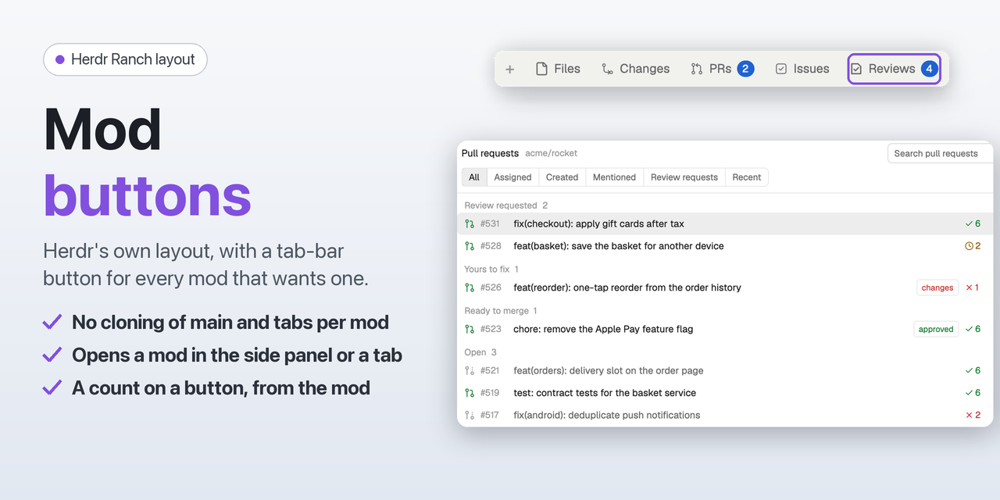

# Mod buttons

Herdr's own "Herdr" layout, with one change: the tab bar shows a button next to Files and Changes for every installed mod that declares one in its `mod.json`. A mod opens in the side panel like Files does, or as a tab of its own. Nothing is hard-coded: with no such mod installed, the tab bar looks like Herdr's.



**Needs:** nothing else; it works with any mod that declares a `button` (for example the Pull requests and Issues mods in this repository). Programs: `sh`, to list the installed mods.

## What you see

- The "Herdr" layout as shipped in 0.1.9: spaces and agents on the left, tabs as pills on top, panes as cards, the side panel on the right, the status bar at the bottom.
- **Tab bar, right side:** **+**, **Files**, **Changes**, then one button per declaring mod in `order` (then label order): its icon (14px, tinted) and label, `selected` background while its panel or tab is shown.

## How it behaves

- **Declaring a button** (in the mod's own `mod.json`; `herdr-app check` accepts the extra key):
  ```json
  { "place": "none", "button": { "label": "PRs", "icon": "pr.svg", "opens": "panel", "order": 10 } }
  ```
  `icon` is an SVG in the mod's folder (optional). `opens` is `"panel"` (default) or `"tab"`. `order` sorts the buttons, lowest first; without it a button gets 100, and equal orders sort by label.
- **"panel":** the button shows or hides the side panel with that mod, like Files and Changes, and the choice is remembered per space. When the layout's `panel-body` stack has no block for the mod, `mod-buttons-bar` adds `{ "id": "<mod>", "type": "block", "content": { "mod": "<mod>", "props": { "slot": "panel" } } }` with `layout.set`. Blocks of mods that are no longer installed are removed the same way.
- **Opens in, set by the mod:** a mod can keep its own choice in shared state `mod-settings` as `{ "<mod>": { "opens": "panel" | "tab" } }` (`herdr-ranch-prs` and `herdr-ranch-issues` do, with the cog in their header). It wins over `opens` in `mod.json`. A change shows at once: switching a mod to Panel adds its panel block, switching to Tab hides the panel when it shows that mod.
- **"tab":** the button selects the tab named after the label that holds the mod, or opens one with `tab.new { name, mod, props: { space } }`. A mod tab isn't told which space it is in, so `space` lets a list stick to its own space and stay idle while that space is hidden.
- **Background copies:** a mod with `"background": true` in its `mod.json` gets an invisible block at the end of the `work` column, `{ "id": "background-<mod>", "type": "block", "content": { "mod": "<mod>", "props": { "background": true } }, "size": { "px": 0 } }`, added and removed with `layout.set` like the panel blocks. That copy runs as long as the layout shows, so a mod can watch for things, open dialogs or set counts without a pane of its own (Reviews uses it).
- **Finding mods:** at start and on `herdr-app do mod-buttons-bar.rescan`, `mod-buttons-bar` lists `<appHome()>/mods/*/mod.json` with `sh` (`appHome()` from `herdr`: `~/.config/herdr-app`, or `$HERDR_APP_HOME`). The folder goes to `sh` as a positional argument, not into the script text, and the script ends with `exit 0`, so a last folder without a `mod.json` doesn't fail the scan. A mod without a `button` still gets one when `KNOWN` in `main.js` lists it: mods by others that Herdr Ranch recommends (now `automations`, from DnzzL/herdr-automations), and only while they are installed; a mod's own `button` wins. Installing or removing a mod while Herdr runs needs a rescan (or a layout switch). Nothing polls.
- **Icons:** `svg()` doesn't follow a symlinked mod folder, so each declared icon is copied to `mods/mod-buttons-bar/icons/<mod>.svg`, only when it changed (a write there reloads `mod-buttons-bar`).

- **Counts on buttons:** `shared("mod-badges")[<mod>]` is a number (every space) or `{ <space id>: number }` (per space; the shown space's is drawn). A positive count shows as a small accent pill after the label (99+ above 99); 0 or missing shows nothing.

## Built from

- `layouts/mod-buttons.json`: a `layout.clone` of `main` (0.1.9) with the `tabs` block pointed at `mod-buttons-bar`, the `spaces` block at `herdr-ranch-spaces`, the `agents` block at `herdr-ranch-agents`, the `files` block at `herdr-ranch-files` and `"preview": "layouts/mod-buttons.svg"`. The `panel-body` stack starts with `files` (Herdr's) and `changes`, which shows this repository's `herdr-ranch-changes` (point it back to Herdr's `changes` mod without it).
- `mods/mod-buttons-bar/`: a `mod.clone` of `tabs` (0.1.9). Added: `scan()` (list mods, read `button`, copy icons), `syncLayout()` (panel blocks), `tabButton()`, reading `opens` from `mod-settings`, and a `nextCommand` loop for `rescan`.
- herdr: `spaces`, `panes`, `openOverlay` (Herdr's `new-menu` and `menu`), `theme`, `window`, `settings`, `run` (`layout.set`, `layout.select`, `layout.show`, `layout.hide`, `tab.new`, `tab.select`), `layout`, `shared` (`mod-settings`), `exec`, `nextCommand`, `appHome`.
- Programs: `sh` (`tr`, `cmp`, `cp`, `mkdir`). Reads `mod.json` files of all installed mods; writes only `mods/mod-buttons-bar/icons/`.

## Watch out

- These are copies: they don't get Herdr's updates to the "Herdr" layout or the tab bar. After a Herdr update, clone `main` and `tabs` again and re-apply the changes above.
- Copy `layouts/` and `mods/` into `~/.config/herdr-app` (don't symlink `mod-buttons-bar`: its icons must sit in a real folder).

## Done when

- `herdr-app check mods/mod-buttons-bar` passes and `layout.switch {"name":"mod-buttons"}` shows the layout.
- With no declaring mod installed, the tab bar shows only **+**, **Files** and **Changes**.
- With `herdr-ranch-prs` and `herdr-ranch-issues` installed, **PRs** and **Issues** appear with their icons and open their panels; set one to `"opens": "tab"` and rescan, and its button opens a tab.
